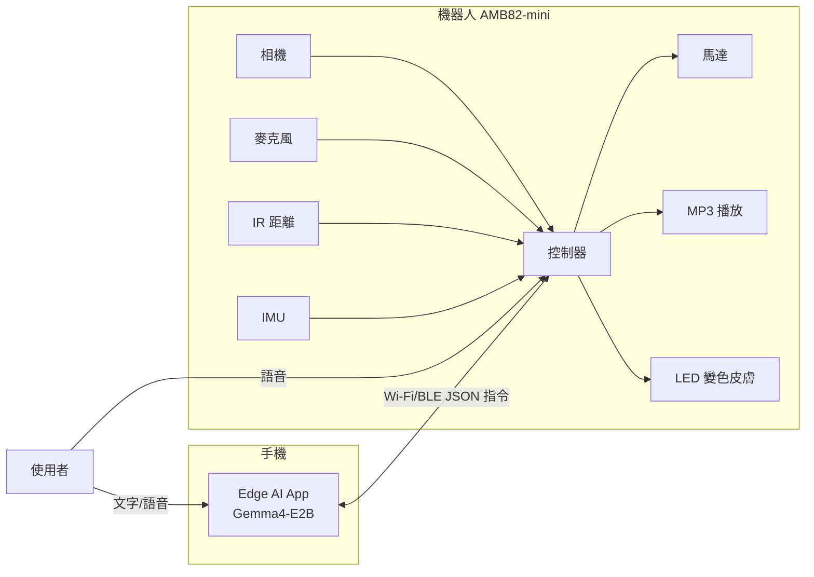

# 🦎 AI Chameleon Robot：邊緣運算智慧變色龍機器人

> 使用晶片：**AMB82-mini**（機器人主控制器）｜邊緣 AI：**Google Edge AI Gemma4-E2B**


## 專案簡介

一隻能**看、聽、說、變色**的陪伴型機器人。
- 以相機觀察環境，LED 皮膚自動**擬態變色**。
- 以 Gemma4-E2B 理解使用者語氣，用**顏色表達情緒**。
- 可透過手機 Edge AI App 操控，也可**直接對機器人說話**。
- 全部運算在邊緣端完成，**離線、保護隱私**。

## 主要功能

| 功能 | 說明 |
|---|---|
| 環境擬態變色 | 相機擷取 → 取得主色調 → LED 漸變 |
| 情緒變色 | 開心黃綠、生氣紅、平靜藍、害怕灰白 |
| 謹慎爬行 | IR 避障、緩慢移動、遇障礙轉眼睛觀察 |
| 驚嚇反應 | IMU 偵測被拿起／搖晃，觸發變色與叫聲 |
| 語音互動 | 麥克風收音 → 理解 → MP3／TTS 回應 |
| Agent 任務 | 「找個地方躲起來」：自主規劃拍照、移動、擬態 |

## 硬體清單

- AMB82-mini 開發板（相機、麥克風、SD 卡 MP3、IR 距離、IMU、馬達驅動）
- 雙輪馬達底盤
- WS2812B RGB LED 燈條（變色皮膚）
- 2 顆微型伺服馬達（雙眼，選配）
- 變色龍外殼（布料／3D 列印）
- 行動電源

## 系統架構



## Agent 工具清單

`capture_image()` · `get_dominant_color()` · `set_skin_color(r,g,b)` · `move(dir, speed)` · `read_distance()` · `read_imu()` · `play_sound(name|tts)` · `rotate_eyes(angle)`

## 兩種互動方式比較

| | Edge AI App（Gemma4-E2B） | 直接對機器人說話 |
|---|---|---|
| 理解能力 | 強，可多輪規劃 | 適合短指令 |
| 沉浸感 | 像操作軟體 | 像和寵物互動 |
| 建議用途 | 設定、進階任務、除錯 | 日常陪伴 |

本專案採**混合式**設計。

## 專案結構
```
├── PROPOSAL.md
├── README.md
├── images/          # AI 合成圖、架構圖
├── firmware/        # AMB82-mini 程式
├── app/             # Edge AI App / Agent 設定
└── sounds/          # MP3 音效
```

## 開發進度

- [ ] 硬體組裝與感測器測試
- [ ] LED 變色與馬達控制
- [ ] App 與 Gemma4-E2B 串接
- [ ] 擬態變色
- [ ] 情緒變色
- [ ] 語音直接互動
- [ ] 成果展示

## 組員

01153123 邱筠婷
01253110 張詠晴


願意參與瑞昱科技計畫評審： 願意
